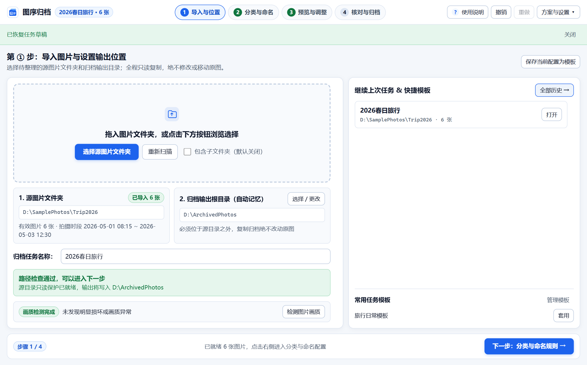
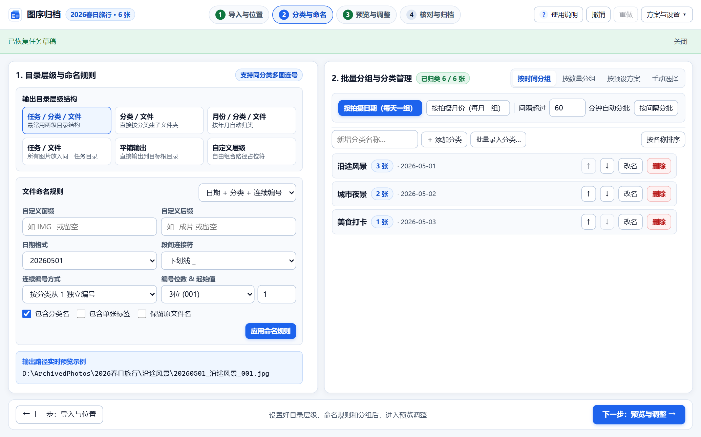
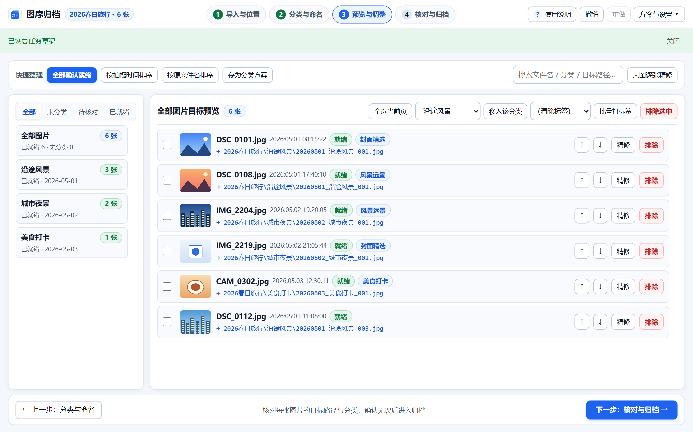
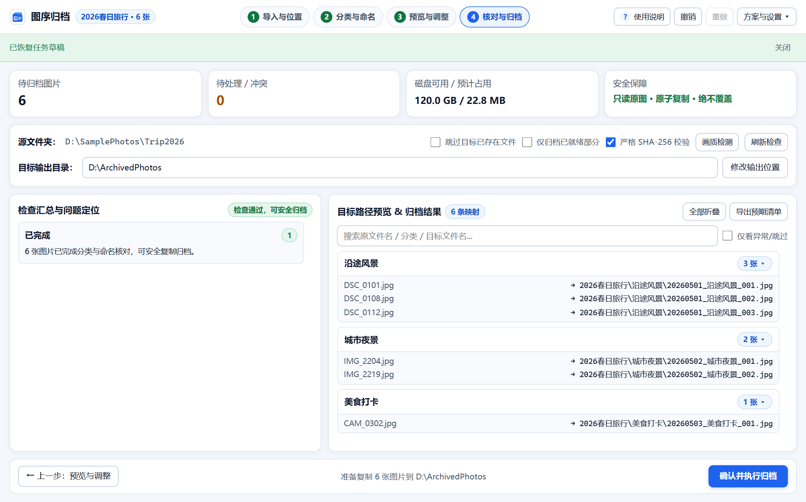

<div align="center">
  
  <h1>TuXu Archive（图序归档）</h1>
  <p>A lightweight, offline, safety-first Windows desktop tool for batch image classification, renaming, and archiving.</p>
  <p>
    <a href="README.md">简体中文</a> | <strong>English</strong>
  </p>
  <p>
    <a href="LICENSE"></a>
    
    
  </p>
</div>

---

## Overview

**TuXu Archive** is built with **Tauri 2 + Rust + TypeScript** for organizing local image collections—such as travel photo albums, product photography, scanned documents/receipts, and design deliverables.

All scanning, grouping, previewing, and file archiving run **100% offline** on your machine with **read-only source protection**, **no-overwrite destination guards**, and **atomic temporary-file commits**.

---

## Screenshots

| 1. Import & Output Location | 2. Categories & Naming Rules |
| :---: | :---: |
|  |  |
| **3. Preview & Fine-Tune** | **4. Verify & Safe Archive** |
|  |  |

---

## Key Features

### 1. Guided 4-Step Workflow + Power-User Precision
1. **Import & Location**: Drag-and-drop or browse source folders (optional recursive scan); extracts EXIF capture timestamps & timezone offsets (gracefully falling back to filesystem mtime when EXIF is missing); supports draft resume and reusable templates.
2. **Categories & Naming**: Flexibly configure folder hierarchies and composable naming templates; includes 4 batch grouping strategies: by time (day / month / capture gap), by count (fixed size / even split / custom counts), by preset scheme, or manual thumbnail multi-select.
3. **Preview & Fine-Tune**: Real-time `source name → target relative path` preview; supports multiple photos per category with automatic sequential numbering; includes a high-res single-photo detail viewer with rotation, per-photo custom naming, batch move/tag/exclude, and keyboard shortcuts (`←/→`, `1~9`, `Enter`, `Delete`, `Ctrl+Z` / `Ctrl+Y`).
4. **Verify & Safe Archive**: Pre-flight checks block overlapping source/output trees, invalid Windows filename segments, target collisions, and low disk space; post-archive actions include opening the destination folder, exporting CSV/JSON manifests, and safe undo.

### 2. Flexible Folder Hierarchies & Naming Engine
- **Directory Layouts**: `{task}/{group}`, `{group}`, `{month}/{group}`, `{task}`, flat output root, or custom pattern expressions.
- **Naming Tokens**: `{prefix}`, `{suffix}`, `{task}`, `{group}`, `{tag}`, `{date}`, `{datetime}`, `{year}`, `{month}`, `{day}`, `{seq}` (per-group or global, configurable start index & zero padding), and `{orig}`.

### 3. Safety & Recovery Guarantees
- **Read-Only Source Protection**: Source folders and original files are never modified, moved, or deleted.
- **Zero Silent Overwrites**: Existing destination files and rule-induced filename collisions are rejected explicitly.
- **SQLite Job Recovery**: Archive intentions and per-item states are persisted in SQLite so interrupted jobs can resume cleanly.
- **Identity & Hash-Verified Undo**: Records FileId and SHA-256 for created copies; undo only removes unmodified copies produced by that job and warns on externally edited files.
- **Isolated Runtime**: Uses its own identifier (`local.tuxu.archive`), single-instance mutex (`Local\TuXuArchive`), data directory (`%LOCALAPPDATA%\TuXuArchive\data`, override via `TUXU_DATA_DIR`), and runtime extraction directory (`%LOCALAPPDATA%\TuXuArchive\runtime`).

---

## Download

Grab prebuilt binaries from the [Releases](https://github.com/rowanjove/TuXuArchive/releases) page (no Rust, Node.js, or separate VC++ Redistributable required; only Windows 10/11 built-in WebView2 Runtime):

- **`TuXuArchive_v1.0_x64.exe`**: Standalone self-extracting launcher (statically linked MSVC CRT `+crt-static`, extracts & verifies SHA-256 into `%LOCALAPPDATA%\TuXuArchive\runtime`).
- **`TuXuArchive_v1.0_Portable_x64.zip`**: Portable archive containing `TuXuArchive.exe` and `manifest.sha256`.
- **`SHA256SUMS.txt` & `dependency-report.json`**: Release checksums and PE DLL import audit.

---

## Development, Testing & Release Build

### Prerequisites
- Windows 10 / 11 (x64)
- Rust toolchain (`rustc` / `cargo` with MSVC Build Tools)
- Node.js 20+ & npm

### Commands

```powershell
# Install frontend dependencies
npm install

# Run frontend unit tests and production build
npm test
npm run build

# Launch Tauri dev mode (Vite on port 1422)
npm run tauri dev

# Run Rust workspace lints & full test suite (core + integration + Tauri + launcher)
cargo clippy --workspace --all-targets
cargo test --workspace

# Run sanitization & hygiene check
powershell -ExecutionPolicy Bypass -File .\scripts\sanitization_check.ps1

# Build standalone release artifacts into dist-release/<timestamp>/
powershell -ExecutionPolicy Bypass -File .\build-release.ps1
```

### Repository Layout

```text
.
├─ crates/tuxu-core/        # Core engine: scanning, EXIF sorting, grouping, naming, archive/undo, SQLite
├─ src-tauri/               # Tauri 2 desktop shell, IPC commands & Windows single-instance/DPI helpers
├─ launcher/                # Standalone self-extracting launcher with SHA-256 & atomic runtime swap
├─ src/                     # TypeScript UI, virtualized lists, and pure workflow logic
├─ tests/                   # Frontend workflow unit tests
├─ scripts/                 # Icon generator, Windows PE DLL check, sanitization audit scripts
└─ build-release.ps1        # End-to-end release build script
```

---

## License

Licensed under the [Apache License 2.0](LICENSE).
