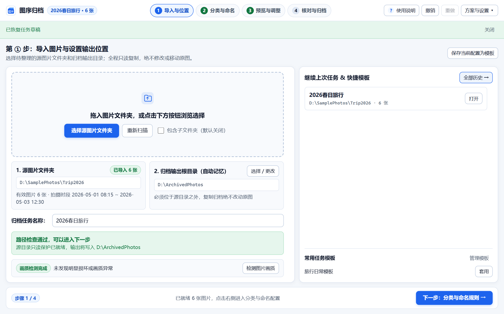
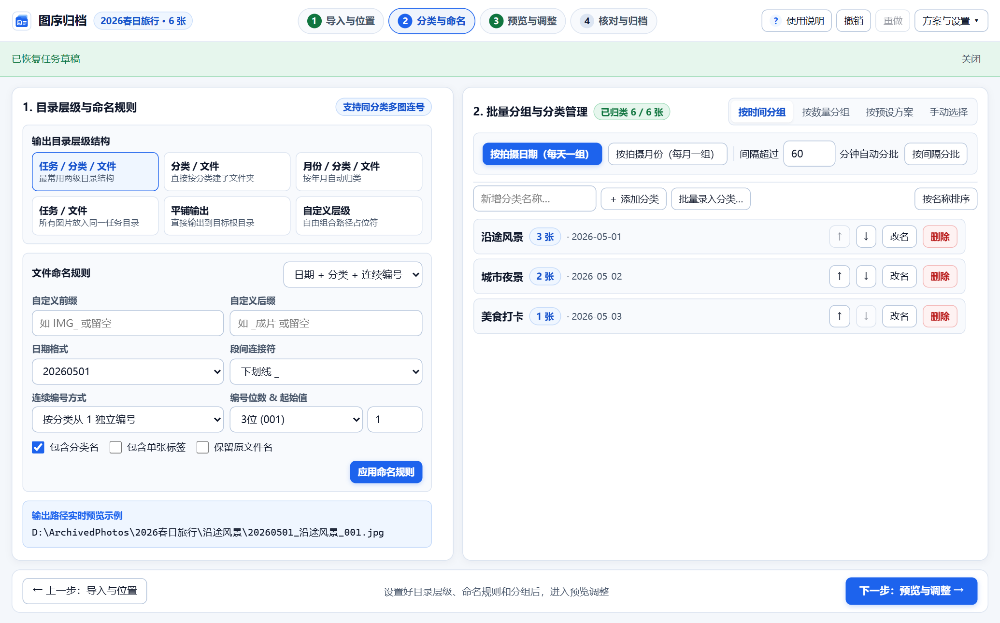
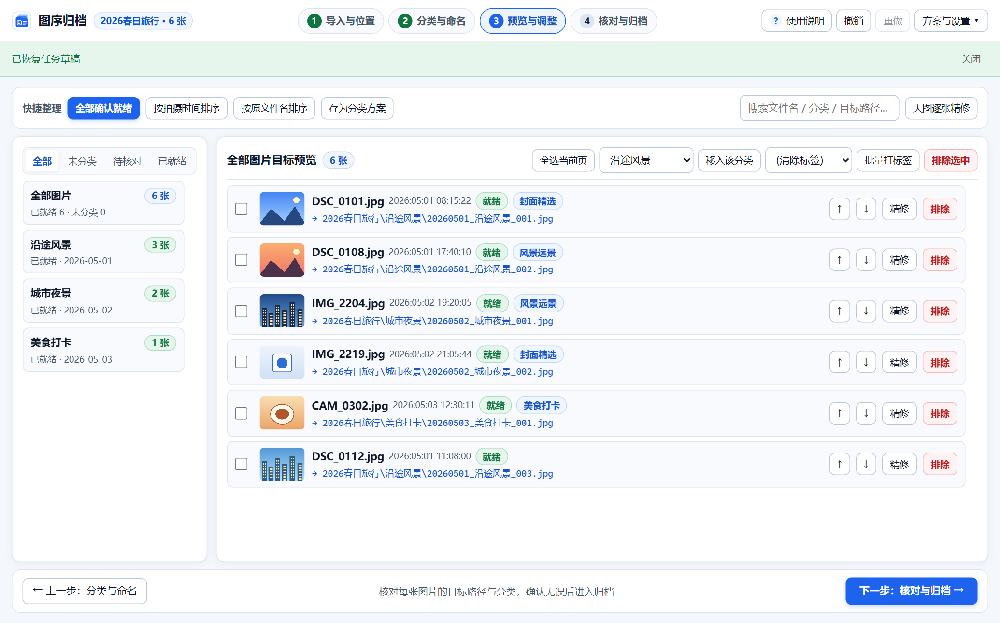
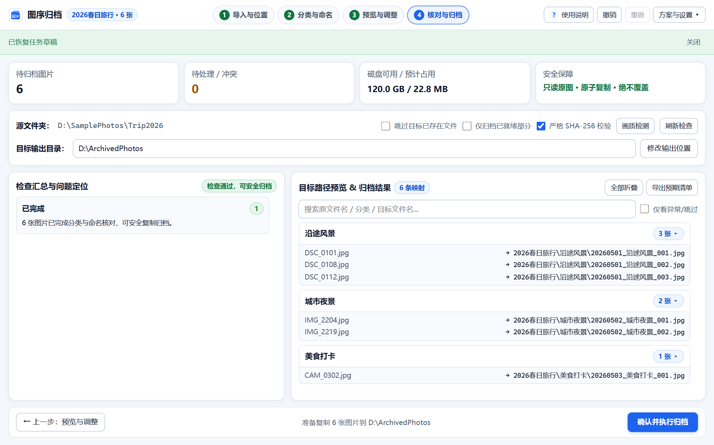

<div align="center">
  
  <h1>图序归档（TuXu Archive）</h1>
  <p>一款轻量、离线、安全可靠的 Windows 通用图片批量分类、重命名与归档工具</p>
  <p>
    <strong>简体中文</strong> | <a href="README.en.md">English</a>
  </p>
  <p>
    <a href="LICENSE"></a>
    
    
  </p>
</div>

---

## 简介

**图序归档（TuXu Archive）** 基于 **Tauri 2 + Rust + TypeScript** 构建，专为本地图片批量整理设计，适用于旅行相册整理、商品素材归档、文档票据扫描留存、设计项目分卷管理等常见场景。

软件采用**原图只读保护 + 临时文件校验 + 原子不覆盖提交**机制，所有处理均在本地离线完成，不联网上传任何图片或元数据。

---

## 界面预览

| ① 导入与位置 | ② 分类与命名 |
| :---: | :---: |
|  |  |
| **③ 预览与调整** | **④ 核对与归档** |
|  |  |

---

## 核心特性

### 1. 清晰四步新手流程，兼顾高阶精修
1. **导入与位置**：支持拖入文件夹或浏览选择（可选是否递归子目录）；自动提取 EXIF 原始拍摄时间与时区信息排序（无 EXIF 时自动回退文件系统修改时间并明确标注）；支持草稿断点恢复与任务模板保存。
2. **分类与命名**：自由配置目录层级与组合命名模板；内置四种批量分组模式（按拍摄日期/月份/间隔、按固定张数/均分/自定义数量、按预设方案、手动缩略图框选）。
3. **预览与调整**：实时预览每张图片的 `原文件名 → 预期目标路径`；支持同一分类存放多张图片并通过连续编号自动消重；支持「大图逐张精修」、画面旋转、自定义单图文件名、批量移组/打标签/排除废片，以及键盘快捷键（`←/→`、`1~9`、`Enter`、`Delete`、`Ctrl+Z` / `Ctrl+Y`）。
4. **核对与安全归档**：执行前自动拦截路径重叠、非法字符、重名冲突与磁盘空间不足；执行后支持打开输出目录、导出 CSV / JSON 清单及安全撤销。

### 2. 灵活目录层级与命名引擎
- **目录层级预设**：
  - `{task}/{group}`（任务 / 分类 / 文件）
  - `{group}`（分类 / 文件）
  - `{month}/{group}`（月份 / 分类 / 文件）
  - `{task}`（任务 / 文件）
  - 平铺直接输出到目标根目录
  - 完全自定义层级表达式
- **支持命名占位符**：
  `{prefix}` 自定义前缀、`{suffix}` 自定义后缀、`{task}` 任务名、`{group}` 分类名、`{tag}` 标签名、`{date}` 日期、`{datetime}` 日期时间、`{year}`、`{month}`、`{day}`、`{seq}` 连续编号（支持按分类或全局从指定起始值补零编号）、`{orig}` 原文件名。

### 3. 文件保护与异常恢复
- **原图零改动**：只读共享方式扫描与读取图片，绝不删除、覆写或移动源文件夹内的任何文件。
- **目标零覆盖**：在规划阶段与原子提交阶段双重检测目标路径与同名冲突，拒绝静默覆盖已有文件。
- **事务级恢复**：SQLite 持久化归档作业意图与每项状态，意外中断后重启可继续恢复未完成条目。
- **基于指纹的安全撤销**：记录每份副本的文件身份（FileId）与 SHA-256，撤销时仅清理校验未改动的本次副本，外部修改过的文件会被保留并提示。
- **独立运行时隔离**：独立应用标识 `local.tuxu.archive`、互斥锁 `Local\TuXuArchive`、数据目录 `%LOCALAPPDATA%\TuXuArchive\data`（可通过 `TUXU_DATA_DIR` 覆盖）。

---

## 下载与使用

前往本仓库的 [Releases 页面](https://github.com/rowanjove/TuXuArchive/releases) 下载分发包（无需安装 Rust、Node.js 或 VC++ 运行库，仅需 Windows 10/11 系统自带的 WebView2 Runtime）：

- **`TuXuArchive_v1.0_x64.exe`**：免安装自解压单文件版（静态链接 MSVC CRT `+crt-static`，自动校验释放到 `%LOCALAPPDATA%\TuXuArchive\runtime` 后启动）。
- **`TuXuArchive_v1.0_Portable_x64.zip`**：绿色压缩包版，解压后直接运行 `TuXuArchive.exe`。
- **`SHA256SUMS.txt` / `dependency-report.json`**：校验和与 PE 依赖扫描报告。

---

## 本地开发、测试与打包

### 环境要求
- Windows 10 / 11 (x64)
- Rust 工具链（`rustc` / `cargo`，建议 1.85+，Visual Studio C++ Build Tools）
- Node.js 20+ 与 npm
- Python 3（可选，仅用于重新生成图标资源）

### 常用命令

```powershell
# 安装前端依赖
npm install

# 前端单元测试与生产构建
npm test
npm run build

# 启动桌面端开发模式（Vite 端口 1422）
npm run tauri dev

# 运行 Rust 全工作区静态检查与测试（核心引擎 + 集成测试 + Tauri + 启动器）
cargo clippy --workspace --all-targets
cargo test --workspace

# 脱敏与规范自检
powershell -ExecutionPolicy Bypass -File .\scripts\sanitization_check.ps1

# 构建正式分发产物（输出位于 dist-release/<timestamp>/）
powershell -ExecutionPolicy Bypass -File .\build-release.ps1
```

### 仓库结构

```text
.
├─ crates/tuxu-core/        # 核心引擎：扫描、EXIF 时间排序、分组、命名引擎、规划/复制/撤销、SQLite 持久化
├─ src-tauri/               # Tauri 2 桌面壳、IPC 命令与 Windows 单实例/窗口适配
├─ launcher/                # 免安装自解压单文件启动器（校验 SHA-256 与安全目录替换）
├─ src/                     # TypeScript 前端 UI、虚拟滚动列表与纯函数工作流模块
├─ tests/                   # 前端工作流单元测试
├─ scripts/                 # 图标生成、PE DLL 依赖检查、脱敏检查脚本
└─ build-release.ps1        # 一键正式发布构建脚本
```

---

## 开源协议

本项目基于 [Apache License 2.0](LICENSE) 开源。
